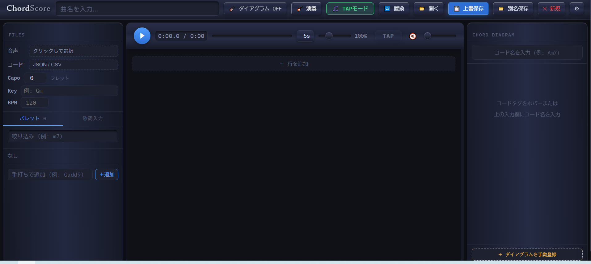
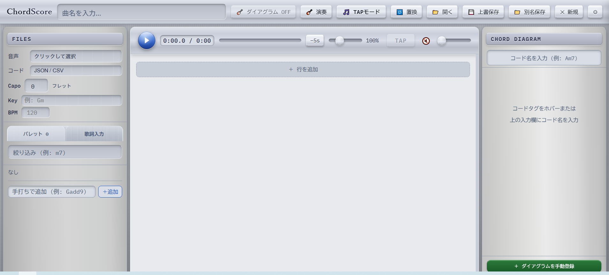
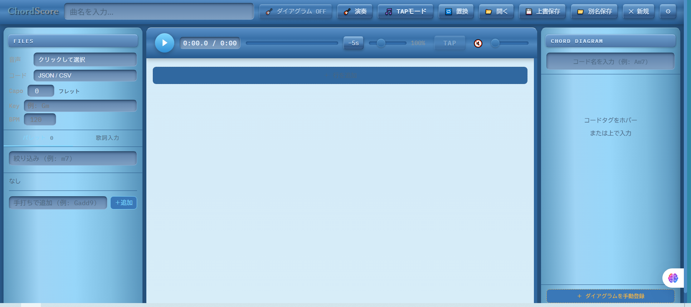
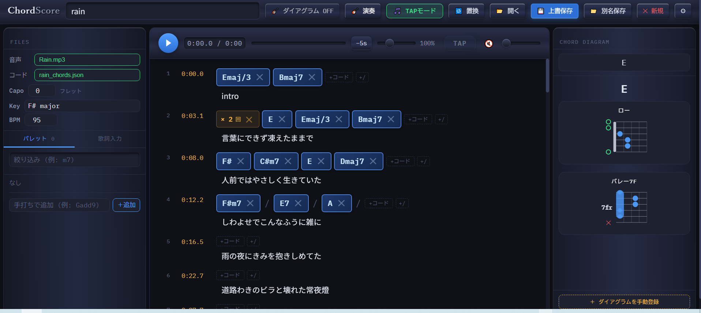
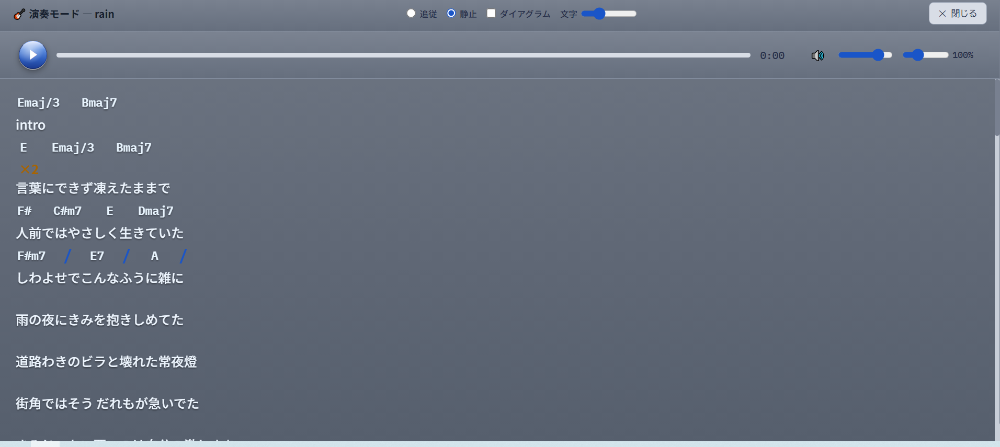
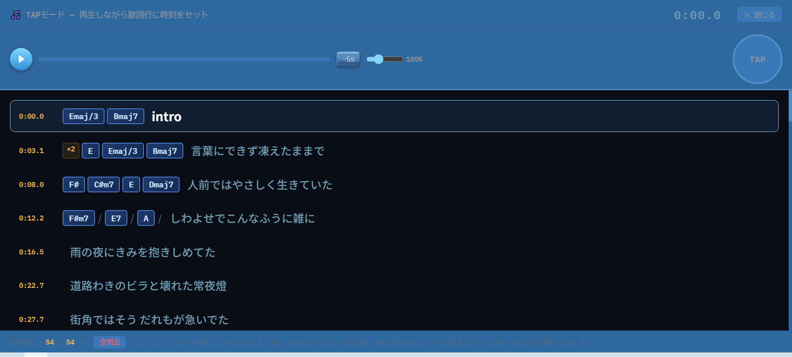

# CreateChordScore Tool

音声ファイルからコード譜を作成するツール
## スクリーンショット

## 起動と待受範囲

`scripts/ChordScoreを起動.bat`（または `python server.py`）で起動し、ブラウザで `http://localhost:8767/index.html` を開きます。サーバーは**このPCからのみ**接続できます（LAN内の他の端末からは接続できません）。詳しくは [docs/server-network.md](docs/server-network.md)。
